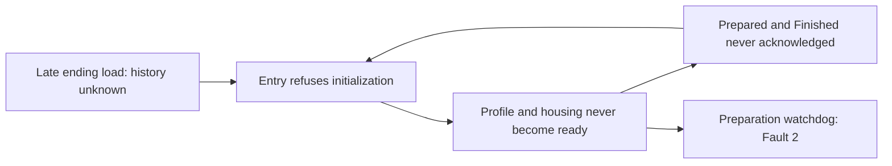
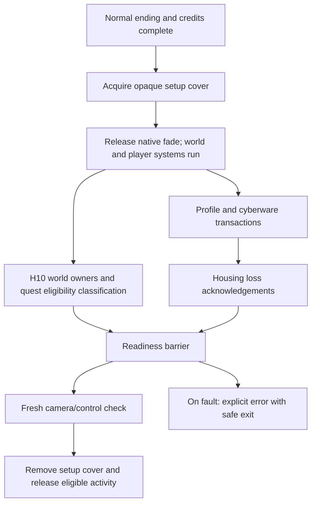

# Startup failure and loading presentation investigation

24 October 2026. Investigation and proposed implementation; no startup patch
has been built or installed by this investigation.

The user reports that the latest core/cosmetic test has no crash, freeze,
missing model or missing textures. The corresponding 14:18 session ended with
a normal RED4ext shutdown at 14:26. This is a successful stability/appearance
test, not a new test of Tower initialization.

## Confirmed failure

The startup has a circular dependency. Loading late in Things Done Changed
freezes unknown pre-Tower quest history without setting `endingObserved` or
creating a certificate. `PreAlphaEntry.Activated()` then requires either that
history or an already **finished** handoff. But the handoff cannot finish until
the same entry system initializes the profile and housing and publishes
`Prepared`.

Evidence comes from the actual installed sources and retained AutoSave-8 and
AutoSave-9. Both serialize `frozen=true` in PreAlphaEntry; the other history
fields are omitted/default. Both have `ControlReady=1`, `CameraAligned=1`,
`CoverReleased=1`, optical readiness and `Fault=2`. Profile/body initialization
fields are omitted/default, and housing has not activated its loss transaction.
These are saved observations, not a current live-memory reading.

The world restoration baseline uses a different admission path. That explains
why vendors and H10 geometry could return while profile restrictions and housing
failed. This is not missing mod files: all 109 installed Tower files still match
the prior expected hashes, including the current 2.5 lighting rebase.

Relevant installed source locations:

- `PreAlphaEntry.reds`: Restored at line 75, Freeze at 183, EstablishedHandoff
  at 210, Activated at 217, Poll at 220, profile start at 237–240, readiness
  after line 244. Frozen late loads cannot enter the history-observation branch.
- `HousingState.reds`: ProfileReady at 223, MigrationContext at 227 and
  HousingReadyForReveal at 289.
- Native transition builder: the preparation race waits for `PTFRPA2_Reveal`,
  with a **180-second maximum**, rather than an intended fixed setup duration.
  The separate initial control maximum is 60 seconds. Delay node 142 is 300
  **milliseconds**, not five minutes.

## Repair boundary

Separate **permission to initialize the post-ending player/world** from
**proof that an individual quest may be restored**.

The new core initialization predicate should require genuine completed Tower
conditions, the existing native handoff acknowledgements, a valid local player,
camera/optics readiness and no unhandled transaction fault. It must not require
`Prepared` or `Finished`, which are its outputs. It must not create or alter a
pre-Tower certificate, change `endingObserved`, or re-enable development fixture
admission. Keep certification and native prerequisites on each quest operation.

For late-ending saves with no recorded quest history, initialize the profile,
housing and supported world state; mark affected quests **deferred: history
unknown**. Finishing initialization cannot make those quests eligible. Preserve
completed rewards, earned unfinished progress and existing owners. A supported
unfinished quest resumes; an unsupported continuation remains deferred.

The already failed AutoSave-8/9 branch needs a separate, bounded continuation.
The native timeout cancels both waiters and exits to its failure branch. Merely
clearing `Fault=2` does not restart that owner. A successor must recognize the
exact completed-arrival/failed-preparation state, preserve fault evidence,
validate existing transactions and resume only missing setup. It must not replay
the ending, teleport, camera activation, refunds, housing loss or payments.
Other faults remain stopped for diagnosis. No such repair is installed yet.

Viktor's clinic door remains a separate device/owner issue. Its earlier Ready
facts showed action dispatch, not physical opening. It must not be declared
fixed by this startup repair.

## Proposed loading presentation

Use a mod-owned full-screen **non-pausing setup cover** while the world runs.
Acquire it over the existing opaque transition and confirm it is displayed
before releasing the native fade. Keep it visible until the readiness barrier
passes, then fade it away. For an already initialized save, validate receipts
and readiness and take a short path without repeating initial transactions.

Do not hold the old native blackout until setup is finished. The historical PA2
trace retained Tier5 throughout its wait for Tier1. PA3 fixed that by releasing
the fade before checking readiness. Reintroducing that ordering would reproduce
a deadlock. Keeping the engine's native loading phase open is also unproven:
world/player initialization may depend on that phase ending.

Codeware's installed UI source supports a full-screen canvas and custom popup
notification with an input-blocking token. This is a candidate API, not proof
that a blocking popup leaves every readiness condition unchanged. A focused
prototype must establish all of the following before production use:

- simulation time, DelaySystem callbacks and native quest owners continue;
- the player reaches Tier1, `UI_System.IsInMenu` remains false, and no pause,
  time-dilation or gameplay restriction used by a readiness check is introduced;
- movement, combat and interaction input do not pass through the cover;
- the cover appears before the first exposed H10 frame, including reload;
- detach, death, load and failure remove only this mod's input token and UI;
- Escape offers a safe exit/error route instead of dismissing incomplete setup
  into gameplay or trapping the user indefinitely.

Use real stage labels and completed work counts, such as "Updating profile
12/27" and "Waiting for housing acknowledgement". Do not display an invented
percentage or treat a watchdog expiry as successful setup. Native API behavior
behind `ShowGameNotification` still needs a live check. The source-level UI
candidate is visible in [Codeware's popup manager](https://github.com/psiberx/cp2077-codeware/blob/main/scripts/UI/Popups/Manager/CustomPopupManager.reds);
the installed PR63 copy, rather than moving upstream main, is pinned locally.

The essential readiness barrier should include:

| Work | Required before reveal |
| --- | --- |
| Profile/body/cyberware | Accepted durable transactions complete; exact point/gear checks; native vital pools settled |
| Housing | One-time loss and relationship restrictions acknowledged; receipts preserved; no automatic payment |
| H10 | Local geometry owner acknowledged; correct ownership state; service owner armed only if entitled |
| Quests and activities | Each relevant entry classified as eligible, preserved or deferred; no fabricated history |
| Camera and control | Current player/camera/optics and normal control state rechecked |
| Presentation | Cover and owned input token released together only after success |

An unowned apartment must not block street arrival waiting for interactions
that ownership deliberately disables. Remote vendors, distant streamed actors
and quests with unmet prerequisites must not keep the screen open forever.
Optional calls/scenes should be scheduled after reveal; pure eligibility work
can happen under the cover. This is the practical meaning of "everything set
up": all required initial state acknowledged, with explicit deferred work.

## Speed improvements supported by source evidence

Both failure fixtures contain **14 Body + 5 Relic + 8 other blocked perk ranks**.
The current policies process one rank per roughly one second. That is 27
one-second mutation opportunities if admission succeeds, before other startup
costs. The failed branch never ran these refunds; this is not an observed
27-second deployment measurement.

| Current cost | Proposed change |
| --- | --- |
| One refund per second | One sequential, acknowledged mutation per short bounded tick; test 0.25 seconds first. Recheck safety, native dependency order, exact rank/point delta and ledger on every operation. Never refund concurrently. |
| Entry's five-second dispatch throttle also delays geometry/housing readiness checks | Separate admission retry cadence from readiness. React to acknowledgements with a short polling fallback. |
| Repeated global safe-player gate before even read-only work | Apply safety checks to the specific operation; allow pure validation and preparation independently. |
| Baseline retries startup on a five-second cadence | Notify on owner readiness and only retry unresolved work, with a bounded fallback. |
| Serial startup work | Overlap independent world preparation and eligibility reads with profile work; housing remains dependent on a valid completed profile. |
| Settling measured by tick counts | Keep explicit time-based stability requirements when changing polling rates. Four faster samples must not silently replace a four-second settling interval. |
| Full initialization on repeat loads | Validate saved completion and pending work; never reset completed journals or replay transactions. |

Record per-stage start/end timestamps, operation counts, wait reasons and first
blocking condition. Measure total credits-close-to-reveal time and each critical
path stage on the same retained fixtures. A 0.25-second mutation cadence would
reduce scheduling delay, but no total duration or speedup is verified yet.

## Implementation sequence and acceptance

1. Add a successor startup coordinator/predicate and stage telemetry; retain
   existing persistent classes, fields, catalogues, owner paths and node IDs.
   Validate fresh late-ending admission separately from genuine pre-Tower
   certification. Add an explicit failed-preparation continuation.
2. Build and live-prove the non-pausing cover/input prototype before joining it
   to the handoff. Preserve the existing PA3 fade release and camera behavior.
3. Optimize acknowledged operations and readiness scheduling. Preserve native
   dependency/refund checks and real settling intervals. Compile the full current
   mod stack in workspace, inspect compiled bodies and check schema continuity.
4. Package a hash-guarded successor with backup/rollback. Validate normal ending,
   retained Fault2 recovery, completed reload, death/checkpoint interruption and
   no-history deferral. Compare points, cash, inventory, quest owners and housing
   receipts before/after, and verify there is no visible setup or input leak.

The installed catalogue validation also needs to pass against current 2.5
runtime data once admission is repaired. Compilation alone cannot establish
that or guarantee native callbacks, streaming or the UI behavior above.

Evidence: `diagnostics/startup_logic_20261024_01/assessment_01.json`,
`fixtures_01.json`, `source_checks_01.json`, `input_pins_01.json`,
`installed_verification_01.json` and `live_result_01.json`. Audit passed 11
source assertions; 109 Tower files and current core/cosmetic hashes match.
All 229 current save files remained unchanged during the audit. No game,
framework, cache or save changes; no game launch or fact writes.
